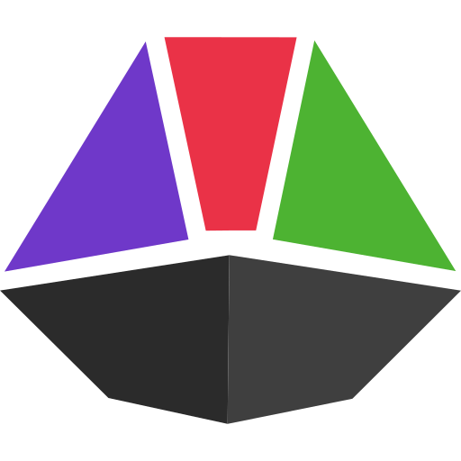

# <picture><source srcset="assets/icon-white.svg" media="(prefers-color-scheme: dark)" /></picture> prismoid

a better chat for Twitch, for viewers, mods and streamers

[](https://prismoid.org)
[](https://github.com/ImpulseB23/Prismoid/releases/latest)
[](CONTRIBUTING.md)
[](docs/)

---

a desktop chat client for Twitch that keeps several channels open as tabs, remembers what was said, and shows moderation as it happens. YouTube and Kick are wired in but switched off until they match Twitch; the goal is one window for all three.

- **tabs and history** - open channels side by side, every message kept locally, backlog when a channel opens
- **moderation you can see** - timeouts, bans and deletions in chat; who did it and why in channels you moderate, with the tools to act
- **emotes everywhere** - 7TV, BTTV and FFZ next to Twitch's own, with an inspect card
- **follows your browser** - switch to the channel in your front browser window automatically
- **no cloud backend** - talks directly to platform APIs from your machine, no account with us

## stack

<table>
	<tbody>
		<tr>
			<td><strong>Rust</strong> (Tauri 2)</td>
			<td>desktop shell, message processing, emote scanning</td>
		</tr>
		<tr>
			<td><strong>Go</strong> (sidecar)</td>
			<td>network I/O, WebSocket connections, OAuth, platform APIs</td>
		</tr>
		<tr>
			<td><strong>TypeScript</strong> (SolidJS)</td>
			<td>frontend UI, virtual scrolling, emote rendering</td>
		</tr>
	</tbody>
</table>

## development

prerequisites: Rust toolchain, Go 1.26+, Node.js 20+, bun

```bash
cd apps/desktop
bun install
cargo tauri dev
```

## screenshots

> coming soon

## docs

see [`docs/`](docs/) for architecture, platform API details, performance requirements, and decision records.

## license

[GPL-3.0](LICENSE)
